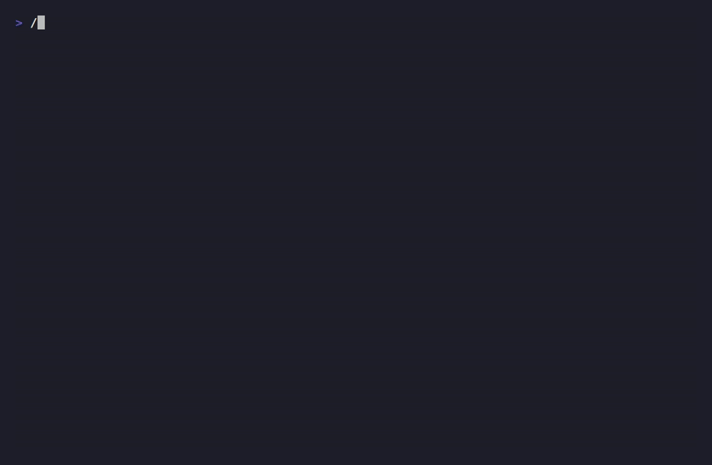

# prompt

<!-- ALL-CONTRIBUTORS-BADGE:START - Do not remove or modify this section -->
[](#contributors-)
<!-- ALL-CONTRIBUTORS-BADGE:END -->
[](https://github.com/nao1215/prompt/actions/workflows/unit_test.yml)

[](https://github.com/nao1215/prompt/actions/workflows/gitleaks.yml)
[](https://github.com/nao1215/prompt/actions/workflows/trivy.yml)
[](https://github.com/nao1215/prompt/actions/workflows/govulncheck.yml)
[](https://github.com/nao1215/prompt/actions/workflows/gosec.yml)
[](https://github.com/nao1215/prompt/actions/workflows/reviewdog.yml)
[](https://pkg.go.dev/github.com/nao1215/prompt)
[](./LICENSE)
[](https://scorecard.dev/viewer/?uri=github.com/nao1215/prompt)


prompt is a Go library for interactive command-line prompts: a read loop with completion and history that runs on Linux, macOS, and Windows. It is a maintained replacement for the archived [c-bata/go-prompt](https://github.com/c-bata/go-prompt).



The animation is [example/demo](./example/demo), a toy SQL shell recorded from [demo.tape](./example/demo/demo.tape). Run it with `go run ./example/demo`.

## Features

- Tab completion, with fuzzy matching and completer-chosen replacement spans
- History with arrow keys, a history file, and reverse search (Ctrl+R)
- Emacs-style key bindings and multi-line input
- Built-in color themes and input highlighting
- Options passed to `prompt.New` in the functional options style

## Installation

```bash
go get github.com/nao1215/prompt
```

Building needs Go 1.26 or later.

## Quick start

### Basic usage

```go
package main

import (
    "context"
    "errors"
    "fmt"
    "log"
    "github.com/nao1215/prompt"
)

func main() {
    p, err := prompt.New("$ ")
    if err != nil {
        log.Fatal(err)
    }
    defer p.Close()

    for {
        input, err := p.Run(context.Background())
        if err != nil {
            if errors.Is(err, prompt.ErrEOF) {
                fmt.Println("Goodbye!")
                break
            }
            log.Printf("Error: %v\n", err)
            continue
        }

        if input == "exit" {
            break
        }
        fmt.Printf("You entered: %s\n", input)
    }
}
```

### With auto-completion

```go
package main

import (
    "context"
    "errors"
    "log"
    "github.com/nao1215/prompt"
)

func completer(d prompt.Document) []prompt.Suggestion {
    return []prompt.Suggestion{
        {Text: "help", Description: "Show help message"},
        {Text: "users", Description: "List all users"},
        {Text: "groups", Description: "List all groups"},
        {Text: "exit", Description: "Exit the program"},
    }
}

func main() {
    p, err := prompt.New("myapp> ",
        prompt.WithCompleter(completer),
        prompt.WithTheme(prompt.ThemeNightOwl),
    )
    if err != nil {
        log.Fatal(err)
    }
    defer p.Close()

    for {
        input, err := p.Run(context.Background())
        if err != nil {
            if errors.Is(err, prompt.ErrEOF) {
                break
            }
            continue
        }

        if input == "exit" {
            break
        }
        // Handle commands...
    }
}
```

## Advanced usage

### Fuzzy completion

```go
commands := []string{
    "git status", "git commit", "git push", "git pull",
    "docker run", "docker build", "docker ps",
    "kubectl get", "kubectl apply", "kubectl delete",
}

fuzzyCompleter := prompt.NewFuzzyCompleter(commands)

p, err := prompt.New("$ ",
    prompt.WithCompleter(fuzzyCompleter),
)
```

`NewFuzzyCompleter` matches the whole input before the cursor, ignores case,
and accepts a subsequence, so `git st` finds `git status`, `GIT PU` finds
`git push`, and `dckrbld` finds `docker build`. Accepting a candidate replaces
the input before the cursor.

### Completing a span of your own choosing

By default a suggestion replaces the word before the cursor and is kept only
when that word is a case-sensitive prefix of it. A completer can set `Replace`
to name the span itself, in runes like `Document.CursorPosition`, and the
prompt then skips its own filter.

```go
func completer(d prompt.Document) []prompt.Suggestion {
    word := d.WordBeforeCursor()
    start := d.CursorPosition - len([]rune(word))

    var out []prompt.Suggestion
    for _, kw := range []string{"SELECT", "INSERT", "UPDATE"} {
        // Match case-insensitively, which the built-in filter cannot do.
        if strings.HasPrefix(strings.ToLower(kw), strings.ToLower(word)) {
            out = append(out, prompt.Suggestion{
                Text:    kw,
                Replace: &prompt.Range{Start: start, End: d.CursorPosition},
            })
        }
    }
    return out
}
```

Typing `sel` and pressing Tab yields `SELECT`.

### Custom key bindings

```go
keyMap := prompt.NewDefaultKeyMap()
// Reach the history from a multiline entry, where the arrow keys move the
// cursor between its lines.
keyMap.Bind('\x10', prompt.ActionHistoryUp)   // Ctrl+P
keyMap.Bind('\x0E', prompt.ActionHistoryDown) // Ctrl+N

p, err := prompt.New("$ ",
    prompt.WithKeyMap(keyMap),
)
```

### History

```go
p, err := prompt.New("$ ",
    prompt.WithFileHistory("~/.myapp_history", 1000),
)
```

The file is loaded when the prompt is built and written when an entry is added.
A save writes at most one megabyte of entries, and a file that would lose
entries to that limit is moved aside first, as `file.1` through `file.3`.

For a password or a token, keep no history at all. Nothing is remembered and no
file is read or written:

```go
p, err := prompt.New("password: ",
    prompt.WithoutHistory(),
)
```

### Multi-line submit control

In multiline mode, `WithIsComplete` receives the whole buffer and decides whether
Enter submits it or starts a new line, for example to wait for a trailing `;`.
`WithContinuationPrefix` marks a waiting line so it does not look like a hung
program:

```go
isComplete := func(input string) bool {
    return strings.HasSuffix(strings.TrimSpace(input), ";")
}

p, err := prompt.New("sql> ",
    prompt.WithMultiline(),
    prompt.WithIsComplete(isComplete),
    prompt.WithContinuationPrefix(" ..> "),
)
```

```text
sql> SELECT id,
 ..> name FROM users;
```

The prefix never appears in the returned input.

### Persistent raw mode (REPL loops)

Each `Run` normally enters raw mode and restores it on return, and input that a
pipe or pseudo-terminal sends between two calls can be lost. `WithPersistentRawMode`
keeps raw mode from the first `Run` until `Close` or EOF; Ctrl+C does not release
it. Print your own output between prompts with `\r\n` rather than `\n`.

```go
p, err := prompt.New("$ ",
    prompt.WithPersistentRawMode(),
)
if err != nil {
    log.Fatal(err)
}
defer p.Close()

for {
    line, err := p.Run(context.Background())
    if errors.Is(err, prompt.ErrEOF) || errors.Is(err, prompt.ErrInterrupted) {
        break
    }
    if err != nil {
        log.Fatal(err)
    }
    fmt.Printf("you typed: %s\r\n", line) // note the \r\n
}
```

### Indenting continuation lines

`WithAutoIndent` decides what each new line opens with. It is called with the
input up to where the line breaks, and what it returns is inserted at the start
of the new line:

```go
p, err := prompt.New("sql> ",
    prompt.WithMultiline(),
    prompt.WithIsComplete(func(in string) bool { return strings.HasSuffix(in, ";") }),
    prompt.WithContinuationPrefix("...> "),
    prompt.WithAutoIndent(func(before string) string {
        // Keep the indentation of the line being continued.
        line := before[strings.LastIndex(before, "\n")+1:]
        return line[:len(line)-len(strings.TrimLeft(line, " \t"))]
    }),
)
```

What it returns is part of the input, so it is submitted and recorded in history
like anything else typed.

### Coloring the input

`WithHighlighter` is given the whole input and returns the runs to draw in a
color of their own, as rune offsets into that input:

```go
p, err := prompt.New("sql> ",
    prompt.WithHighlighter(func(input string) []prompt.StyleSpan {
        var spans []prompt.StyleSpan
        for _, kw := range keywordRuns(input) { // your lexer
            spans = append(spans, prompt.StyleSpan{
                Start: kw.start, End: kw.end,
                Color: prompt.Color{R: 198, G: 120, B: 221, Bold: true},
            })
        }
        return spans
    }),
)
```

Text outside every run, or in a run with the zero `prompt.Color`, keeps the
scheme's input color. Highlighting changes colors only, never the cursor or line
wrapping. The highlighter runs on every render, so keep it cheap.

### Handing the terminal to another program

To run an editor, a pager, or another program that draws on the terminal, close
the prompt and open a new one afterwards:

```go
if err := p.Close(); err != nil {
    return err
}

cmd := exec.Command(os.Getenv("EDITOR"), path)
cmd.Stdin, cmd.Stdout, cmd.Stderr = os.Stdin, os.Stdout, os.Stderr
if err := cmd.Run(); err != nil {
    return err
}

p, err := prompt.New("$ ", opts...) // a fresh session takes the terminal back
if err != nil {
    return err
}
```

On Windows the read through go-tty cannot be interrupted, so a prompt opened
while an earlier reader is still blocked may lose keystrokes to it.

### Interrupting work between prompts

While the application runs a submitted line, nothing reads the terminal, so
Ctrl+C either waits for the next line or kills the program as a SIGINT.
`WatchInterrupt` returns a context that Ctrl+C cancels during that work:

```go
for {
    line, err := p.Run(context.Background())
    if errors.Is(err, prompt.ErrEOF) {
        break // Ctrl+D at an empty prompt ends the session
    }
    if errors.Is(err, prompt.ErrInterrupted) {
        continue // Ctrl+C discards the line being typed
    }
    if err != nil {
        return err
    }

    ctx, stop := p.WatchInterrupt(context.Background())
    err = runQuery(ctx, line) // a long query, an import, anything slow
    stop()

    if errors.Is(err, context.Canceled) {
        fmt.Print("canceled\r\n")
        continue
    }
    if err != nil {
        fmt.Printf("%v\r\n", err)
    }
}
```

Other keys typed during the work are delivered to the next `Run` in order. Do
not call `Run` while a watch is active. See
[`WatchInterrupt`](https://pkg.go.dev/github.com/nao1215/prompt#Prompt.WatchInterrupt)
for repeated and nested interrupts.

## Key bindings

| Key | Action |
|-----|--------|
| Enter | Submit input |
| Ctrl+C | Discard the current line and return ErrInterrupted |
| Ctrl+D | EOF when buffer is empty |
| ↑/↓ | Navigate history (or lines in multi-line mode) |
| ←/→ | Move cursor |
| Ctrl+A / Home | Move to beginning of line |
| Ctrl+E / End | Move to end of line |
| Ctrl+K | Delete from cursor to end of line |
| Ctrl+U | Delete the line the cursor is on, which on an entry of one line is the whole of it |
| Ctrl+W | Delete word backwards |
| Ctrl+R | Reverse history search; Tab and ↑/↓ move through the matches, Enter accepts the one the search names, Esc cancels |
| Tab | Auto-completion |
| Backspace | Delete character backwards |
| Delete | Delete character forwards |
| Ctrl+L | Clear the screen and redraw the prompt at the top of it, keeping the scrollback |
| Ctrl+←/→ | Move by word boundaries |
| Esc | Close the completion popup |

The completion menu closes when the word before the cursor changes, and the next
Tab asks the completer again. It lists at most ten candidates, fewer when the
terminal has fewer rows under the input, and Up and Down scroll longer lists.

## Color themes

Without a theme, the input and the candidates use the terminal's foreground, and
only the prefix, the selected candidate, and descriptions are colored. The zero
`prompt.Color` means the terminal's own color, so black is `prompt.Color{B: 1}`.

```go
// Available themes
prompt.ThemeDefault
prompt.ThemeDark
prompt.ThemeLight
prompt.ThemeAccessible
prompt.ThemeSolarizedDark
prompt.ThemeVSCode
prompt.ThemeNightOwl
prompt.ThemeDracula
prompt.ThemeMonokai

// Usage
p, err := prompt.New("$ ",
    prompt.WithTheme(prompt.ThemeDracula),
)
```

A `ColorScheme` sets foreground colors only; the terminal keeps its background
and cursor.

## Examples

The [example](./example) directory has complete programs:

- [Basic usage](./example/basic) - a simple prompt
- [Auto-completion](./example/autocomplete) - tab completion with suggestions
- [Command history](./example/history) - history navigation and persistence
- [Multi-line input](./example/multiline) - multi-line editing
- [Interactive shell](./example/shell) - a file explorer shell
- [Demo](./example/demo) - the toy SQL shell in the animation above: context-aware completion, syntax highlighting, and multi-line statements

## Notes

### Thread safety

Drive one prompt from one goroutine. The exception is ending a session: from
another goroutine, cancel the context passed to `Run` (it returns
`context.Canceled`) or call `Close` (it returns `ErrEOF`).

### Error handling

- `prompt.ErrEOF`: Ctrl+D on an empty buffer, the input reaching its end, or a `Run` on a prompt that is already closed. It matches `io.EOF` as well as itself
- `prompt.ErrInterrupted`: Ctrl+C
- `context.DeadlineExceeded`: the context deadline passed
- `context.Canceled`: the context was canceled

## Testing

| Technique | Bug class caught here |
|---|---|
| Examples and unit tests ([example_test.go](example_test.go), [keymap_test.go](keymap_test.go)) | A public function that no longer does what its godoc shows, or a key the read loop no longer answers |
| Pseudo-terminal tests ([pty_reader_test.go](pty_reader_test.go)) | A prompt that loses keystrokes when it is closed and opened again, or when the terminal is resized under it, on a real terminal |
| Property-based tests ([property_test.go](property_test.go)) | A cursor split, a history or a saved history file that loses, repeats or reorders what was typed |
| Metamorphic and differential tests ([property_test.go](property_test.go)) | A fuzzy match list that reorders when unrelated candidates change, or a word, line or match that disagrees with `strings` and `regexp` |
| Fuzzing ([renderer_test.go](renderer_test.go), [history_test.go](history_test.go), [viewport_test.go](viewport_test.go), [highlight_test.go](highlight_test.go)) | A layout that leaves the screen, or a history line that does not read back as it was written |
| Mutation testing ([.github/workflows/mutation.yml](.github/workflows/mutation.yml)) | A test that runs a changed comparison or bound without noticing the change |

How to run each one is in [doc/testing.md](doc/testing.md).

## Contributing

See the [Contributing Guide](./CONTRIBUTING.md). Development needs Go 1.26 or
later and golangci-lint, and tests run on Linux, macOS, and Windows.

## Contributors ✨

Thanks goes to these wonderful people ([emoji key](https://allcontributors.org/en/reference/emoji-key/)):

<!-- ALL-CONTRIBUTORS-LIST:START - Do not remove or modify this section -->
<!-- prettier-ignore-start -->
<!-- markdownlint-disable -->
<table>
  <tbody>
    <tr>
      <td align="center" valign="top" width="14.28%"><a href="https://debimate.jp/"><br /><sub><b>CHIKAMATSU Naohiro</b></sub></a><br /><a href="https://github.com/nao1215/prompt/commits?author=nao1215" title="Code">💻</a> <a href="https://github.com/nao1215/prompt/commits?author=nao1215" title="Documentation">📖</a></td>
    </tr>
  </tbody>
</table>

<!-- markdownlint-restore -->
<!-- prettier-ignore-end -->

<!-- ALL-CONTRIBUTORS-LIST:END -->

This project follows the [all-contributors](https://github.com/all-contributors/all-contributors) specification. Contributions of any kind welcome!

## License

[MIT License](LICENSE)
